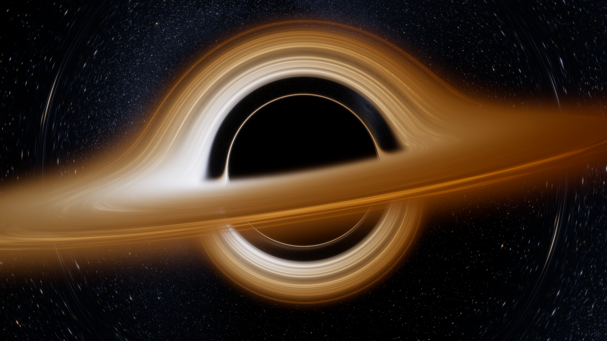

# Black hole



A procedurally generated black hole, ray-traced in a [three.js](https://threejs.org) fragment shader.
No textures or photos: everything in the image comes from code.

## What is simulated

- **Gravitational lensing.** Every pixel is a light ray integrated (RK4) along a null geodesic of a
  Schwarzschild black hole. That gives the shadow, the photon ring, the arch of the far side of the
  disk bent over the top, and the lensed star field with its Einstein-ring arcs.
- **Accretion disk.** A thin disk from the ISCO (3 Rs) outwards, with a faint haze around it.
  Colour comes from a blackbody temperature profile, shifted by relativistic Doppler beaming and
  gravitational redshift, which is why one side is white-hot and the other deep orange.
  Rings, gaps and sheared spiral filaments are baked from procedural noise.
- **Sky.** Procedural stars (colour from blackbody temperature) and a faint Milky Way band.
- **Post.** Multi-scale bloom, ACES tone mapping, vignette, dithering.

## Usage

```sh
npm install

npm run render                       # 3840x2160, 3x3 samples/pixel -> blackhole.png
npm run render -- --width 1920 --height 1080 --samples 2 --out preview.png
npm run render -- --elevation 12 --roll 0 --rOut 16     # any option from src/blackhole.js

npm start                            # live view at http://localhost:8080
```

`npm run render` drives headless Chromium via Playwright with software WebGL, so it needs no GPU
(the 4K render takes several minutes on CPU). `npm start` renders the same shader in your browser,
which is much faster on a real GPU.

## Layout

| File | Role |
| --- | --- |
| `src/shaders.js` | all GLSL: disk texture bake, geodesic ray marcher, bloom, composite |
| `src/blackhole.js` | three.js pipeline and the default parameters |
| `src/main.js`, `index.html` | browser entry |
| `render.mjs` | headless render to PNG |
